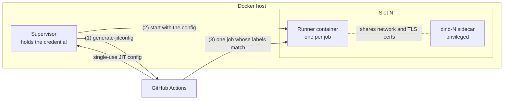

# github-runner-dind

Ephemeral self-hosted GitHub Actions runners in our own Docker image, each paired with its own Docker-in-Docker (dind) daemon, kept as a warm pool by a supervisor that hands every runner a **single-use just-in-time (JIT) config**.

- **Our own image.** It starts from `ubuntu:24.04`, pinned by digest. Every tool is pinned to an exact version and verified against its published checksum or signed package repository: the Actions runner, PowerShell 7, .NET SDK, Node.js and npm, the Docker CLI and Compose plugin, and Playwright Chromium. It holds no secrets and runs as an unprivileged user.
- **No long-lived credential in a runner container.** The supervisor mints a JIT config per runner with GitHub's `generate-jitconfig` API. A container only ever gets the config for its own single-job runner.
- **A brand-new container per job.** `docker run --rm` gives every job a fresh filesystem. The dind daemon is cleaned before each job.
- **Isolated from the host's Docker.** Jobs get their own dind daemon, so they can't see or control the host's containers, and no host directories are mounted.
- **Maintained.** The image is rebuilt weekly and on every change on GitHub-hosted runners, scanned with Trivy, published with an SBOM and provenance, and kept current by Dependabot plus a weekly version check.

## How it works



1. For every free slot, the supervisor asks GitHub's `generate-jitconfig` API for a **single-use runner config**. The supervisor holds the credential (a `gh` login or a GitHub App); containers never see it.
2. It starts a brand-new runner container with that config (`docker run --rm`), attached to the slot's Docker-in-Docker sidecar: it shares the sidecar's network namespace and mounts its TLS client certificates read-only.
3. GitHub dispatches **one** queued job whose `runs-on` labels match to the idle runner.
4. When the job ends, the runner deregisters, its container exits and is removed, and the supervisor starts a replacement within seconds. A runner that exits within 60 seconds counts as a failure and is retried with back-off.

Where the parts come from:

| Part | Defined in | Runs |
|---|---|---|
| Docker-in-Docker sidecars, one per slot | `compose.yaml` (`dind-1`, `dind-2`, …) | always, restarted by Docker |
| Supervisor | `supervisor/runner-supervisor.ps1` | on the host, or as the `supervisor` service in `compose.yaml` ([recommended](#running-the-supervisor-in-docker-recommended)) |
| Runner containers | started by the supervisor, from this repository's image | one job each |

The runners serve either one repository (`-Repository`) or an organization's runner group (`-Organization`), so several private repositories can share one pool.

## Quick start

Requirements: Docker (Docker Desktop on Windows), PowerShell (Windows PowerShell 5.1 or PowerShell 7), and a credential that can create runners for the repository (see below).

```powershell
git clone https://github.com/lucem-labs/github-runner-dind
cd github-runner-dind
./supervisor/runner-supervisor.ps1 -Repository owner/repo -Labels ci -Image ghcr.io/lucem-labs/github-runner-dind@sha256:<digest>
```

To share one pool between several repositories, register the runners with an organization instead:

```powershell
./supervisor/runner-supervisor.ps1 -Organization my-org -RunnerGroupId 1 -Labels ci -Image ghcr.io/lucem-labs/github-runner-dind@sha256:<digest>
```

The runner group's **repository access** decides which repositories can use the runners: set it to the selected private repositories (org **Settings → Actions → Runner groups**). In organization mode the supervisor refuses to start while the group allows public repositories.

The supervisor starts the dind sidecars (`docker compose up`), removes leftovers from earlier runs, and keeps the pool running until stopped. Target the runners in workflows by label:

```yaml
jobs:
  test:
    runs-on: [self-hosted, linux, ci]
```

**Pin the image by digest** rather than using `latest`.

### Credential (`-Auth`)
Minting JIT configs needs *Administration: write* on the repository, or *Self-hosted runners: write* on the organization. The credential stays with the supervisor on the host and never enters a container.

- **`gh` (default):** the host user's GitHub CLI login (`gh auth login`), which must have admin access to the repository. For `-Organization`, the user must be an org owner and the login needs the `admin:org` scope (`gh auth refresh -s admin:org`). There's no new secret to create or store, but the token is as broad as your account.
- **`app`:** a GitHub App installed **only** on the repository (or organization), with the repository permission **Administration: Read and write** (or the organization permission **Self-hosted runners: Read and write**) and nothing else. Run with `-Auth app -AppId <id> -AppPrivateKeyPath <path to .pem>` under PowerShell 7. The supervisor signs a short-lived JWT with the key to get one-hour installation tokens. This is least privilege and independent of any user account. Restrict the key file's ACL to the account running the supervisor.

### Running the supervisor in Docker (recommended)
The `supervisor` service in `compose.yaml` runs the supervisor from the runner image, next to the dind sidecars. Docker restarts it with Docker Desktop (`restart: unless-stopped`), so there is no scheduled task, and its log is `docker compose logs supervisor`.

It needs a **GitHub App** credential, because the host's `gh` login isn't available in a container: create an App with only the permission listed under [Credential](#credential--auth), install it on the repository or organization, and generate a private key. Then put the settings in a `.env` file next to `compose.yaml`, or pass them with `--env-file`:

```dotenv
RUNNERS_PROJECT=my-runners
RUNNERS_TARGET=-Organization my-org        # or -Repository owner/repo
RUNNERS_NAME_PREFIX=my-ci
RUNNERS_LABELS=ci
RUNNER_IMAGE=ghcr.io/lucem-labs/github-runner-dind@sha256:<digest>
GITHUB_APP_ID=<app id>
GITHUB_APP_KEY_FILE=C:/path/to/app-private-key.pem
```

```powershell
docker compose --profile supervisor up --detach    # start or update
docker compose --profile supervisor logs supervisor
docker compose --profile supervisor stop           # stops and deregisters the runners
```

The supervisor container mounts the host's Docker socket, which it needs to start runner containers. That gives it control over everything else in that Docker engine too, the same as a supervisor running on the host. Runner containers never get the socket.

### Running it permanently on the host (Windows)
Register a scheduled task that starts at logon (Docker Desktop must be running) and restarts on failure:

```powershell
$script = 'C:\path\to\github-runner-dind\supervisor\runner-supervisor.ps1'
$arguments = "-NoProfile -WindowStyle Hidden -ExecutionPolicy Bypass -File `"$script`" -Repository owner/repo -Labels ci -Image ghcr.io/lucem-labs/github-runner-dind@sha256:<digest>"
Register-ScheduledTask -TaskName 'GitHub runner supervisor' `
  -Action (New-ScheduledTaskAction -Execute 'powershell.exe' -Argument $arguments) `
  -Trigger (New-ScheduledTaskTrigger -AtLogOn -User $env:USERNAME) `
  -Settings (New-ScheduledTaskSettingsSet -ExecutionTimeLimit 0 -RestartCount 999 -RestartInterval (New-TimeSpan -Minutes 1) -MultipleInstances IgnoreNew)
```

`-WindowStyle Hidden` keeps the task's console window from being closed by accident; closing it stops the supervisor and its runners. Only one supervisor (or `-Cleanup`) can run per `-Project` at a time: a second one refuses to start, because two would remove each other's runners as leftovers. Stop the task before running the supervisor by hand.

Stopping the task kills the supervisor without its tidy-up. That's fine: the next start removes leftover containers and registrations. To tidy up by hand, run it with `-Cleanup`.

## Configuration

Supervisor parameters:

| Parameter | Default | Meaning |
|---|---|---|
| `-Repository` | | `owner/repo` the runners serve |
| `-Organization` | | Organization the runners serve instead; exactly one of `-Repository` and `-Organization` is required |
| `-Slots` | `2` | Number of runners. Each needs a `dind-N` service in `compose.yaml`. |
| `-Labels` | `ci` | Custom labels; `self-hosted`, `linux` and `x64` are always added |
| `-Image` | `ghcr.io/lucem-labs/github-runner-dind:latest` | Runner image; pin by digest |
| `-Project` | `github-runners` | Compose project of the dind sidecars, and the prefix for container and volume names |
| `-NamePrefix` | `runner` | Runners are named `<prefix>-<slot>-<random>`. Also selects which registrations count as leftovers, so use a prefix unique to this supervisor. |
| `-Auth`, `-AppId`, `-AppPrivateKeyPath` | `gh` | Credential, see above |
| `-RunnerGroupId` | `1` | Runner group (1 is the default group); with `-Organization` it must not allow public repositories |
| `-PollSeconds` | `5` | How often slots are checked |
| `-ExternalSidecars` | | Don't start the dind sidecars; something else does (the compose `supervisor` service) |
| `-Once` | | Fill the pool once and exit, leaving the runners running |
| `-Cleanup` | | Remove this project's runner containers and registrations, then exit |

Docker-in-Docker limits come from `RUNNER_CPUS` and `RUNNER_MEMORY` (defaults `4` and `6g`, per daemon) in the environment or a `.env` file next to `compose.yaml`. `compose.yaml` defines two sidecars; to add slots, copy `dind-2` with the next number and its volumes.

### What persists between jobs
- **Package caches:** `~/.nuget` and `~/.npm` are Docker volumes per slot (`<project>_runner-N-nuget`, `…-npm`), so restores stay fast.
- **Docker images** in each dind daemon (for example `postgres:17-alpine`), so they aren't pulled every time. Containers, networks and volumes in the daemon are removed before every job.
- **Nothing else.** Every job runs in a new container.

### Tests that start containers
A runner container shares its slot's dind network namespace. A job that runs `docker run --publish 127.0.0.1::5432 …` can therefore reach the container on `127.0.0.1:<port>`, as on a normal machine, and concurrent runners can't collide on ports.

## Isolation model

**What it protects against:**
- jobs reading or changing the host's Docker containers and volumes, because the host's Docker socket is never mounted into a runner container (only into the optional `supervisor` service);
- jobs reading host files, because no host directories are mounted;
- jobs obtaining a credential that can create runners: the PAT, `gh` token or App key stays with the supervisor on the host;
- one job seeing another's leftovers, because of a new container per job and a cleaned dind daemon.

**Known limits:**
- **A job can read its own runner's credential.** The JIT config, and the `.runner` / `.credentials` files the runner writes from it, belong to the same user the job runs as. That's inherent to how the Actions runner works. The credential is only valid for that single runner, which takes one job and then deregisters.
- **The dind sidecar must run `privileged`.** Code that controls a job can start privileged containers on its dind daemon, and a determined attacker could use that to escape to the Docker host (on Docker Desktop, its Linux VM). So treat these runners as **trusted-code runners**:
  - only attach them to **private** repositories whose code you trust;
  - never attach them to a public repository, because anyone who can open a pull request could run code on them;
  - don't run untrusted or third-party pull requests on them.

  Stronger isolation needs a different runtime, such as Sysbox, rootless dind on a Linux host, or a VM per job.

## Updating

- **Base image, dind image and GitHub Actions:** Dependabot opens pull requests.
- **Tools pinned by version** (`ARG …_VERSION` in the `Dockerfile`): the weekly `check-versions` workflow opens or updates a *Pinned tool updates available* issue. Bump the version **and its checksum**; each `ARG` has a comment saying where the checksum comes from. Keep `DOCKER_CLI_VERSION` in step with the dind image, and `PLAYWRIGHT_VERSION` in step with the consuming projects' `@playwright/test`.
- **Vulnerabilities with no fixed upstream release** go in `.trivyignore.yaml`. Each entry is scoped to the exact file, has a statement explaining why it's acceptable for now, and has an expiry date (at most about 30 days ahead), after which the scan fails again. Delete an entry as soon as a fixed release can be pinned.
- **The runner never auto-updates.** GitHub stops accepting runner versions some time after a new release, so keep `RUNNER_VERSION` current.

Every change is built, scanned and only pushed from `main`. Consumers then bump their pinned digest.

## Troubleshooting

- **`The GitHub CLI is not logged in`:** run `gh auth login` as the user the supervisor runs as, or use `-Auth app`.
- **`could not start a runner (… 403 …)`:** the credential lacks admin access to the repository (*Administration: write*), or for an organization the `admin:org` scope or *Self-hosted runners: write*.
- **`Runner group '…' allows public repositories`:** in org **Settings → Actions → Runner groups**, turn off *Allow public repositories* for that group.
- **`Docker-in-Docker sidecar is not healthy yet`:** check `docker compose logs dind-1`. It needs `privileged: true`.
- **A slot keeps restarting** (`exited after Ns; retrying`): look at the container's output. `docker logs` won't work because the container is already removed; run the image by hand with `-Once`, or check the job log on GitHub.
- **A job stays queued:** check that the runners are online in the repository's (or organization's) **Settings → Actions → Runners**, that the job's `runs-on` labels match, and for org runners that the runner group gives the repository access.
- **The dind data volumes grow:** images accumulate. Stop the supervisor, run `docker compose down`, remove `<project>_dind-N-data`, then start the supervisor again.

## License

[MIT](LICENSE)
